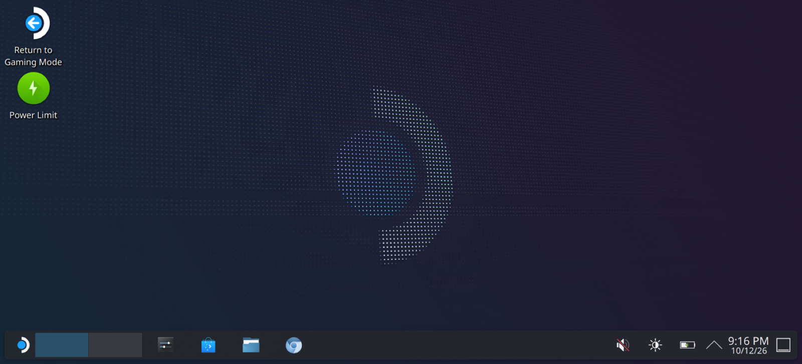

# Aston Linux: SteamOS (ARM) on the OnePlus 12R

Notes, patches and tools from a working port of **Valve's official SteamOS for ARM** to the
**OnePlus 12R** (codename `aston`, Snapdragon 8 Gen 2 / SM8550, Adreno 740), dual-booted
next to OxygenOS on the A/B slots. Before that it ran Debian with KDE Plasma Mobile.

Nobody has written a mainline kernel for this phone. Everything here runs on the
**LineageOS downstream Android kernel** with a few patches and the vendor modules.
Nothing touches the bootloader, which stays OnePlus-signed.

The author has since reverted the phone to stock, so this repository is a **starting point
for anyone (human or AI) who wants to continue the port**. It has what was learned, what
worked, what didn't, and the code that made it work.



## What worked

| Area | State |
|---|---|
| Boot | Custom `init` in the slot-A `init_boot` ramdisk, Linux rootfs on a partition split from `userdata` |
| Dual boot | OxygenOS on slot B, Linux on slot A; slot-A "successful" flag kept set so the bootloader doesn't fall back |
| Kernel | LineageOS `android_kernel_oneplus_sm8550`, rebuilt with user/PID namespaces, devtmpfs, SysV IPC (KABI-safe), all 721 vendor modules unchanged |
| Display | Native 1264×2780 DSI panel at 120 Hz, 10-bit, driven directly by KWin or Gamescope; landscape |
| GPU | Mesa Turnip on Android's **KGSL** interface, Vulkan 1.4, OpenGL 4.6 through Zink |
| SteamOS | Valve's SteamOS ARM image (Steam Frame build), Steam Deck UI, Gaming Mode in Gamescope, Desktop Mode (Plasma) |
| PC games | Windows games through Proton 11 (ARM64) and FEX; *The Looker* and *Just Cause 3* ran |
| Steam Quick Access | TDP limit, GPU clock ceiling, performance profile and charge limit wired into Steam's own sliders |
| Wi-Fi | WCN7850 through the downstream `qca_cld3_kiwi_v2` driver, NetworkManager |
| Bluetooth | WCN7850 BT, with a custom userspace firmware loader and HCI bridge |
| Controllers | Xbox-compatible pads over Bluetooth, Steam Input, controller-as-mouse on the desktop |
| Haptics | OnePlus linear motor via force-feedback, including the predefined shaped effects |
| Video | Hardware H.265/H.264 **encode** (gameplay recorder) and decode at driver level (`msm_vidc`, V4L2, DMABUF-only) |
| Power/thermal | Load-following CPU, OnePlus factory thermal tables, whole-phone power limit (dual-cell aware) |

## What didn't

Internal speakers, earpiece and mics (no sound card without Android's audio HAL), cameras,
fingerprint, sensors, mobile data/calls, suspend (kernel aborts it), HDR/VRR, the native
Freedreno GL driver for scanout, MangoHud with Valve's build, Valve's system updater (it
would overwrite the adaptation). The [status chart](docs/06-status.md) has details.

## Read this first

- **[docs/07-safety-and-recovery.md](docs/07-safety-and-recovery.md)**: OnePlus anti-rollback
  e-fuses can **permanently brick** this phone. Read it before flashing anything.
- [docs/01-device.md](docs/01-device.md): hardware facts read from the device
- [docs/02-boot-and-kernel.md](docs/02-boot-and-kernel.md): partition split, A/B slots, init ramdisk, kernel patches
- [docs/03-graphics-and-display.md](docs/03-graphics-and-display.md): KGSL Turnip, the display quirks, Gamescope shims
- [docs/04-steamos.md](docs/04-steamos.md): putting Valve's SteamOS ARM image on this phone
- [docs/05-hardware-bringup.md](docs/05-hardware-bringup.md): Bluetooth, Wi-Fi, haptics, video, audio, power, thermals
- [docs/06-status.md](docs/06-status.md): the full feature chart
- [docs/08-next-steps.md](docs/08-next-steps.md): open problems worth attacking

## Repository layout

```
boot/      custom pid-1 init for the slot-A ramdisk (SteamOS + Debian), and the Debian-only version
patches/   Mesa (Turnip KGSL) patch, kernel SysV-IPC KABI patch, kernel config fragment
tools/     on-device daemons and helpers, host-side packing and flashing scripts, test programs
docs/      the write-up
```

## What is *not* in this repo, and why

- **Firmware, vendor modules, boot images, OxygenOS/LineageOS/SteamOS images.** These are
  proprietary or large. The docs say where each one came from, so you can extract
  it from your own device or download it from the original source.
- **Prebuilt binaries** (busybox, the Mesa build, static sgdisk). Build them from source.
- **Personal data:** SSH keys, Wi-Fi details and screenshots containing account data.

## Status of this repository

This is documentation of a finished experiment, not a maintained distribution. Scripts
contain hard-coded paths and device-specific assumptions and were run by hand over SSH.
Read each one before running it. Issues and pull requests that move the port forward are welcome.

## License

MIT for the original code and docs in this repository (see [LICENSE](LICENSE)). The
patches in `patches/` modify GPL-2.0 (Linux) and MIT (Mesa) projects and are under those
projects' licenses.
